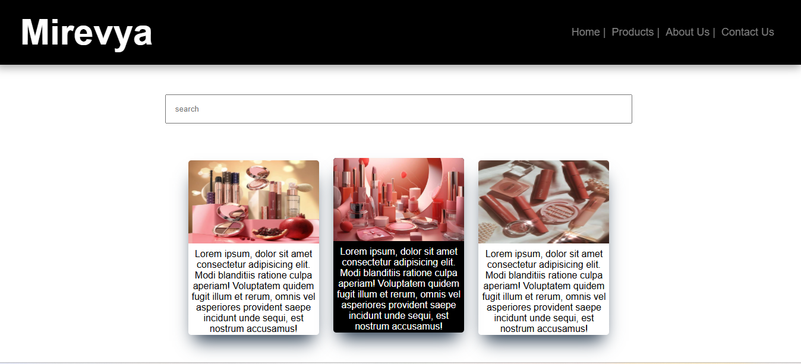

# 💄 Mirevya – Makeup Product Website

Mirevya is a beginner-friendly makeup product showcase website built using HTML5 and CSS3. It features a simple layout for displaying product images, along with navigation, a search input, an About Us section, and contact information.

## 🌐 Live Demo

[](https://inthusha20241647-commits.github.io/mirevya-website/)

## 📸 Preview

<p align="center">
  
</p>

## ✨ Features

- 💄 **Product Showcase:** Displays makeup product images using individual content cards.
- 🧭 **Navigation Bar:** Includes navigation links for Home, Products, About Us, and Contact Us.
- 🔍 **Search Input:** Provides a search input field in the product section.
- 🖼️ **Image Integration:** Displays product images within the website layout.
- 👩 **About Us Section:** Provides space for introducing the website.
- 📞 **Contact Section:** Displays contact information, including a phone number and email address.
- 🎨 **CSS Styling:** Uses colors, spacing, typography, shadows, and hover effects.
- 📱 **Responsive Styling:** Includes a CSS media query to adjust the layout for smaller screens.

## 🛠️ Technologies Used

- HTML5
- CSS3

## 📂 Project Structure

```text
mirevya-website/
│
├── images/
│   ├── image1.jpg
│   ├── image2.jpg
│   └── image3.jpg
│
├── index.html
├── style.css
└── README.md
```

## 🎯 Learning Objectives

- Practice structuring webpages using HTML.
- Improve CSS styling and layout skills.
- Understand how to display images using HTML.
- Explore CSS hover effects and transitions.
- Practice creating layouts with CSS Flexbox.
- Learn to apply media queries for smaller screens.

---

*This project is part of my continuous learning journey in frontend web development.*
